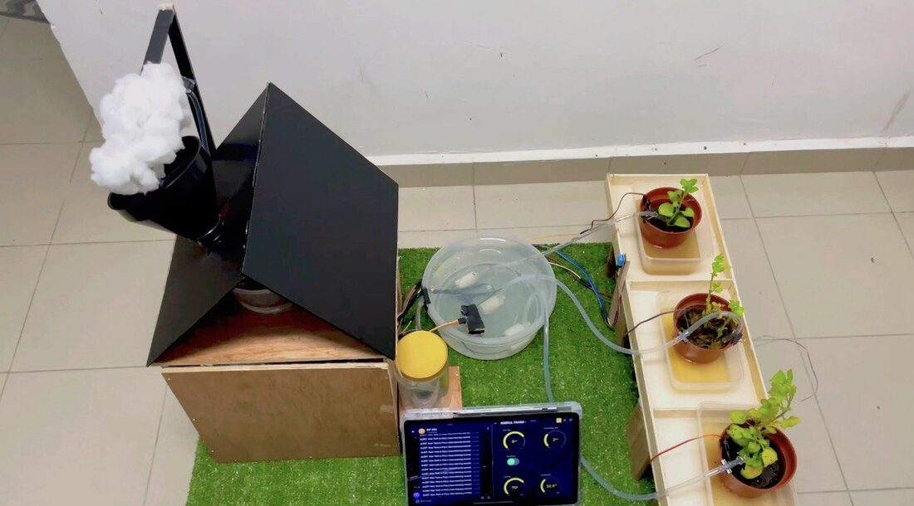
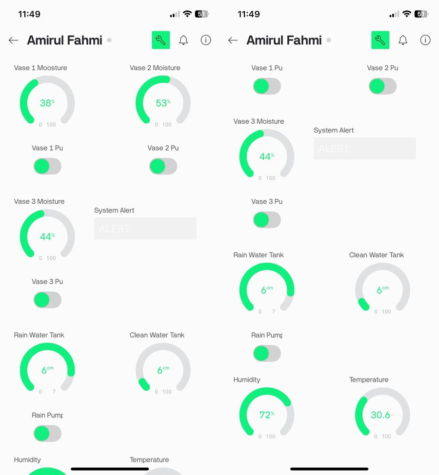
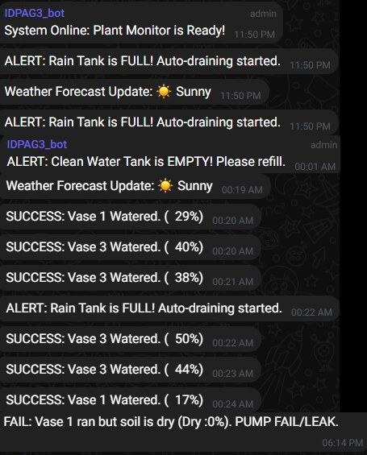
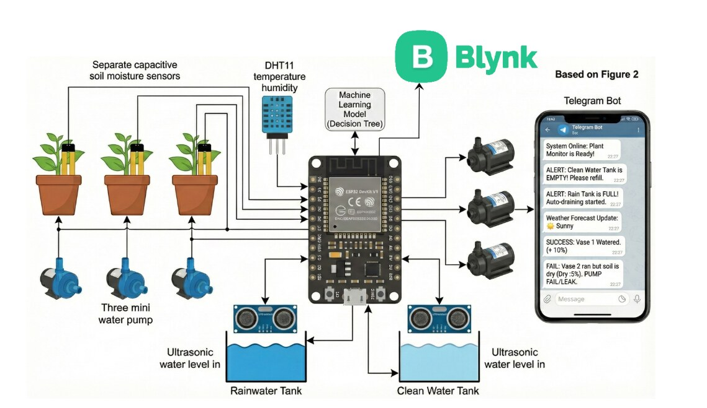
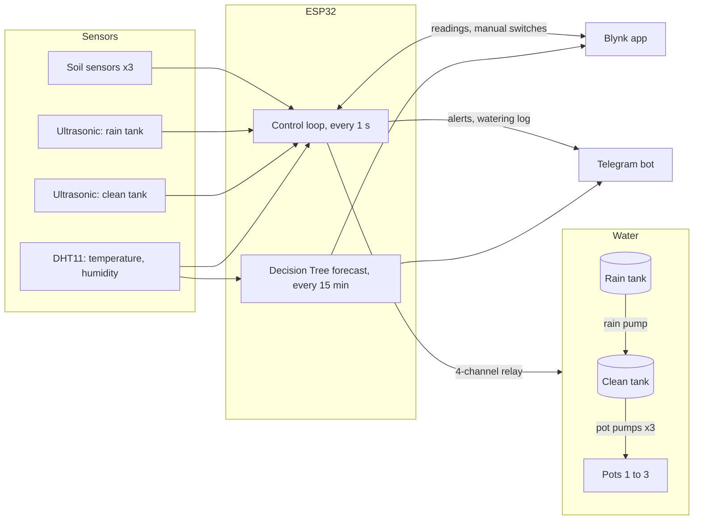
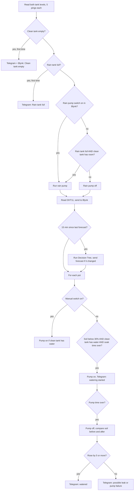
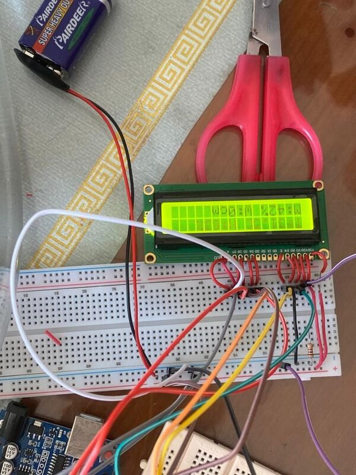

# AG3 Smart Irrigation: Rainwater Harvesting with Soil and Tank Monitoring

**It waters when the soil is dry, not when the clock says so.**

An ESP32 prototype that waters three plant pots from harvested rainwater. Each pot has its own
soil moisture sensor and pump, so a pot is watered only when its soil drops below 30% and the
clean water tank actually has water. Two ultrasonic sensors watch the rain tank and the clean
tank, a Blynk dashboard shows every reading and lets you switch the pumps by hand, and a
Telegram bot sends alerts for an empty tank, a full rain tank or a watering that did not wet the
soil. A Decision Tree trained on Malaysian weather data runs on the ESP32 itself and sends a
Sunny, Cloudy or Rain forecast, with no cloud service needed for the prediction.

Integrated Design Project (IDP), Faculty of Electrical and Electronic Engineering, Universiti Tun
Hussein Onn Malaysia. Team AG3, five students. **Gold, IDP Showcase Day, and second place in the
Agriculture category out of more than ten teams.**

<table>
  <tr>
    <td align="center"></td>
    <td align="center"></td>
    <td align="center"></td>
  </tr>
  <tr>
    <td align="center">The finished prototype: rain catchment roof, two tanks and three pots</td>
    <td align="center">Blynk shows soil moisture, both tank levels, temperature and humidity</td>
    <td align="center">The Telegram bot reports alerts, forecasts and every watering</td>
  </tr>
</table>

## Why

Most home and small-farm watering is either done by hand or on a fixed timer. Both ignore the
soil: plants get water when the soil is already wet (root rot, nutrient run-off) or miss it when
the soil is dry. People with busy schedules forget, and schools, offices and nurseries have too
many pots to check one by one. At the same time, rainwater that could do the job runs straight
into the drain.

This prototype closes that loop with cheap, easy-to-find parts:

| | Timer sprinkler | Manual watering | Commercial smart irrigation | **This project** |
|---|:-:|:-:|:-:|:-:|
| Waters only when the soil is dry | No | Depends on the person | Yes | **Yes** |
| Uses harvested rainwater first | No | No | Sometimes | **Yes** |
| Checks the tank before pumping | No | No | Yes | **Yes** |
| Remote monitoring and alerts | No | No | Yes | **Yes (Blynk + Telegram)** |
| Weather forecast without the cloud | No | No | Usually cloud-based | **Yes (on the ESP32)** |
| Cost | Low | Free | High | **Low** |

## What it does

| Feature | How |
|---|---|
| Per-pot watering | Three capacitive soil sensors, three pumps. Each pot is handled on its own, so one dry pot does not water the others |
| Dry-run protection | A pot pump only runs if the clean tank is not empty (ultrasonic distance below 6 cm) |
| Rainwater transfer | When the rain tank is full and the clean tank has room, a fourth pump moves water from the rain tank to the clean tank |
| Soak time | After each watering burst the pot waits before it can be watered again, so the water has time to spread |
| Leak and pump check | After watering, the soil reading must rise by at least 5 points. If it does not, Telegram reports a possible leak or pump failure |
| Manual control | Four Blynk switches run each pot pump and the rain pump by hand |
| Alerts without spam | "Clean tank empty" and "Rain tank full" are sent once, then locked until the level recovers |
| On-device weather forecast | A Decision Tree turns temperature and humidity into Sunny, Cloudy or Rain every 15 minutes and sends it only when it changes |

## How it works

<p align="center"></p>



### One pass of the control loop

`runSystemLogic()` runs once a second from a `BlynkTimer`:



### Thresholds

All in [`AG3_Smart_Irrigation.ino`](AG3_Smart_Irrigation.ino), section 3:

| Setting | Value | Meaning |
|---|---|---|
| `DRY_THRESHOLDS` | 30, 30, 30 | Soil moisture (%) below which each pot is watered |
| `TANK_EMPTY_THRESHOLD` | 6 cm | Water surface at least this far from the sensor = tank empty |
| `TANK_FULL_THRESHOLD` | 3 cm | Water surface closer than this = tank full |
| `PUMP_DURATION` | 1000 ms | Length of one watering burst |
| `SOAK_COOLDOWN` | 5000 ms | Wait before the same pot can be watered again (testing value) |
| Forecast interval | 900,000 ms | 15 minutes between Decision Tree runs |

The tank thresholds are in centimetres because the prototype tanks are only a few centimetres
deep. A full-size tank needs larger values.

Soil moisture is the raw 12-bit ADC reading mapped linearly from 4095 (dry) to 0 (wet) onto
0 to 100%. Ultrasonic readings average five pings and ignore failed echoes.

## The weather model

| | |
|---|---|
| Data | [Weather Data Malaysia](https://www.kaggle.com/) (S. Varqha, Kaggle, 2024), filtered to the Johor region, 2020 to 2024 |
| Samples | 335,700 after cleaning (the export script loaded 532,098 Johor rows before cleaning) |
| Inputs | Temperature and humidity only, so the model matches what the DHT11 can measure |
| Labels | Made from rainfall: **Sunny** = 0 mm, **Cloudy** = under 1 mm, **Rain** = 1 mm or more |
| Split | 70% train, 15% validation, 15% test |
| Model | Decision Tree, 5 levels, exported from Python to nested `if` statements in [`weather.h`](weather.h) |
| Accuracy | 87% on the test set (from the project report) |
| Speed | Under 50 ms per prediction on the ESP32 |

Humidity is checked first because it had the strongest link to rainfall. Many branches of the
exported tree end in the same class, so the whole tree reduces to these rules:

| Humidity | Temperature | Forecast |
|---|---|---|
| 85.05% or less | any, except below | Sunny |
| 59.75% to 64.45% | 26.25 °C or less | Rain |
| above 85.05% | any, except below | Cloudy |
| above 85.05% | 30.55 °C to 30.85 °C | Rain |
| above 98.5% | above 38.35 °C | Rain |

The forecast never changes the watering. It is advice for the user (for example, "rain is
likely, skip a manual watering"), so the pots are still watered correctly if the forecast is
wrong.

## Wiring

From the code, which is what runs on the board:

| Part | ESP32 pin |
|---|---|
| Soil sensor, pot 1 / 2 / 3 | GPIO 34 / 35 / 32 (analog) |
| Pump relay, pot 1 / 2 / 3 | GPIO 25 / 26 / 27 |
| Ultrasonic, rain tank (trig / echo) | GPIO 5 / 18 |
| Ultrasonic, clean tank (trig / echo) | GPIO 14 / 22 |
| Rain pump relay | GPIO 21 |
| Clean pump relay | GPIO 19 (set up, not used by the logic) |
| DHT11 | GPIO 15 |

The relay board is **active low**: `LOW` turns a pump on, `HIGH` turns it off. Every pump is set
`HIGH` in `setup()` so nothing runs at power-on.

### Blynk datastreams

| Pin | Widget |
|---|---|
| V1, V2, V3 | Soil moisture, pot 1 to 3 (%) |
| V4, V5, V6 | Humidity (all three show the one DHT11) |
| V7 / V8 | Clean tank / rain tank distance (cm) |
| V9 | Temperature (°C) |
| V10 | System alert text |
| V11 | Weather forecast label |
| V12, V13, V14 | Manual switch, pot 1 to 3 |
| V15 | Manual rain pump switch |

## Testing

### Bench test (from the report)

Before the full build, one pot, one pump, the DHT11 and a 16x2 LCD were wired on a breadboard to
check the 30% threshold:

<p align="center"></p>

| Test | Soil moisture | Temperature | Humidity | Pump | LCD | Result |
|---|---|---|---|---|---|---|
| 1 | 15% | 29 °C | 68% | ON | Correct | Pass, dry soil |
| 2 | 25% | 29 °C | 69% | ON | Correct | Pass, dry soil |
| 3 | 30% | 29 °C | 69% | OFF | Correct | Pass, at threshold |
| 4 | 35% | 29 °C | 68% | OFF | Correct | Pass, wet soil |
| 5 | 50% | 29 °C | 69% | OFF | Correct | Pass, wet soil |

### Full system

The Telegram log above comes from the finished prototype: the startup message, rain-tank-full
and clean-tank-empty alerts, a forecast update, successful waterings on pots 1 and 3, and one
"pump ran but soil is dry" warning on pot 1, which is the leak check doing its job.

## Run it

1. Install the [Arduino IDE](https://www.arduino.cc/en/software) and the **esp32** board package
   (Boards Manager), then pick **ESP32 Dev Module**.
2. Install the libraries: **Blynk**, **DHT sensor library** (Adafruit) and **Adafruit Unified
   Sensor**. `WiFi`, `HTTPClient` and `WiFiClientSecure` come with the ESP32 package.
3. In Blynk, create a template with the datastreams above and copy its template ID, name and
   auth token.
4. Create a Telegram bot with [@BotFather](https://t.me/BotFather) and get your chat ID.
5. Fill in the placeholders at the top of `AG3_Smart_Irrigation.ino`:

   | Placeholder | Replace with |
   |---|---|
   | `YOUR_BLYNK_TEMPLATE_ID`, `YOUR_BLYNK_TEMPLATE_NAME`, `YOUR_BLYNK_AUTH_TOKEN` | Your Blynk template |
   | `YOUR_WIFI_CREDENTIALS`, `WIFI PASSWORD` | Wi-Fi name and password (2.4 GHz) |
   | `YOUR_TELEGRAM_TOKEN`, `-YOUR_TELEGRAM_ID` | Bot token and chat ID |
   | `YOUR_TELEGRAM_API_URL` | `https://api.telegram.org/bot` |

6. Keep `weather.h` in the same folder as the sketch, then upload. The bot sends
   "System Online: Plant Monitor is Ready!" when the board connects.

Do not commit the file after filling in your tokens.

## Bill of materials

| Item | Qty | Unit (RM) |
|---|---|---|
| ESP32 DevKit V1 (30-pin) | 1 | 26.30 |
| HC-SR04 ultrasonic sensor | 2 | 3.30 |
| DHT11 temperature and humidity sensor | 1 | 4.90 |
| Capacitive soil moisture sensor v1.2 | 3 | 5.20 |
| 4-channel 5 V relay module | 1 | 13.00 |
| 5 V mini water pump | 4 | |
| 16x2 LCD with I2C (bench test) | 1 | 15.00 |
| Jumper wires, breadboards, clear PVC hose | | |
| DC power supply, enclosure, plywood base, cardboard | | |

The electronics that do the sensing and control cost under RM100. Prices are from the project
report (2026).

## Project structure

```
AG3_Smart_Irrigation.ino   control loop, tank and soil logic, Blynk and Telegram
weather.h                  Decision Tree weather model as C++ if statements
docs/images/               pictures used in this README
```

## Limitations

- **Short watering bursts.** `PUMP_DURATION` is 1 second (its comment says 5) and the soak time
  is 5 seconds, values chosen for demos. A real garden needs longer bursts and minutes of soak
  time.
- **The leak check can raise false alarms.** It compares the soil reading at the end of the
  1-second burst with the reading before it. Soil sensors react more slowly than that, so a pot
  that was watered correctly can still be reported as "soil didn't get wet".
- **Telegram text is not URL-encoded.** Messages are put into the URL as they are, so a `+`
  turns into a space (the log shows "( 29%)" where the code sends "(+ 29%)"), and characters
  such as `&` or `#` would cut a message short.
- **Soil sensors are not calibrated.** The 0 to 100% scale is a straight line over the raw ADC
  range, not fitted to each sensor's real dry and wet readings.
- **The rain-tank-full alert always says "Auto-draining started"**, even when the clean tank is
  also full and the rain pump stays off. The rain tank needs a physical overflow for that case.
- **Manual rain pump ignores the tank levels**, so it can run the clean tank over or the rain
  tank dry.
- **No mains top-up.** The clean-tank pump on GPIO 19 is wired but never switched on, so when
  there is no rain the clean tank has to be refilled by hand.
- **The weather model is a rough guide.** Its labels come from rainfall alone, it cannot tell
  day from night, and Rain is only predicted in the three narrow bands in the table above. The
  87% accuracy mostly reflects telling dry from wet hours.
- **One DHT11** feeds all three humidity widgets.

## Next steps

- URL-encode Telegram messages and move tokens into a separate `secrets.h` that is git-ignored.
- Calibrate each soil sensor (dry and wet readings) and make the burst and soak times longer.
- Re-check the soil a minute after watering before deciding there is a leak.
- Switch the clean tank to mains water when both tanks run low.
- Retrain the forecast with time of day and pressure, and log readings for a season to tune the
  thresholds.
- Power the board from a small solar panel and battery, as the report proposes.

## Built with

ESP32 (Arduino core), C++, Blynk IoT, Telegram Bot API, DHT11, HC-SR04, capacitive soil
moisture sensors, Python and scikit-learn (Decision Tree training, offline).
